<div align="center">


<br><br>


**Upload a resume. Rank every role. See why. Know what to learn next.**

[✨ Showcase](#-showcase) &nbsp;•&nbsp;
[🧠 How it thinks](#-how-algomind-thinks) &nbsp;•&nbsp;
[🚀 Quick start](#-quick-start) &nbsp;•&nbsp;
[🔌 API](#-api-reference) &nbsp;•&nbsp;
[👥 Team](#-team-algomind)

</div>

<br>

## 💡 The problem

Keyword filters look for exact words. A student who writes *"Data analysis using Pandas"* can be missed by a search for *"Data Analyst"*, and rarely learns why.

**AlgoMind reads for meaning.** It extracts your profile, compares it with the roles you care about, explains every score and turns each gap into a plan.

<table>
<tr>
<td width="33%" valign="top">

### 📄 Smart extraction
PDF or DOCX in, structured profile out: skills, education, projects, certifications, experience, internships and achievements. **Every item is editable.**

</td>
<td width="33%" valign="top">

### 🎯 Multi-role ranking
Pick built-in roles or **paste any job description**. Each role gets its own alignment score, ordered highest first.

</td>
<td width="33%" valign="top">

### 🔍 Explainable scores
Skills, project relevance, education fit and experience depth, shown on a **radar chart** with a written reason, plus a **second opinion from the local SBERT engine**.

</td>
</tr>
<tr>
<td valign="top">

### 📊 Skill-gap analysis
Your estimated level against what the role expects, sorted into **High, Medium and Low** priority.

</td>
<td valign="top">

### 🗺️ Learning roadmap
A phased, week-by-week plan with tasks you can **tick off**. Progress is **saved in your browser**.

</td>
<td valign="top">

### ⚖️ Compare and export
View roles **side by side**, spot repeated gaps and **download a report**.

</td>
</tr>
</table>

<br>

## ✨ Showcase

<div align="center">

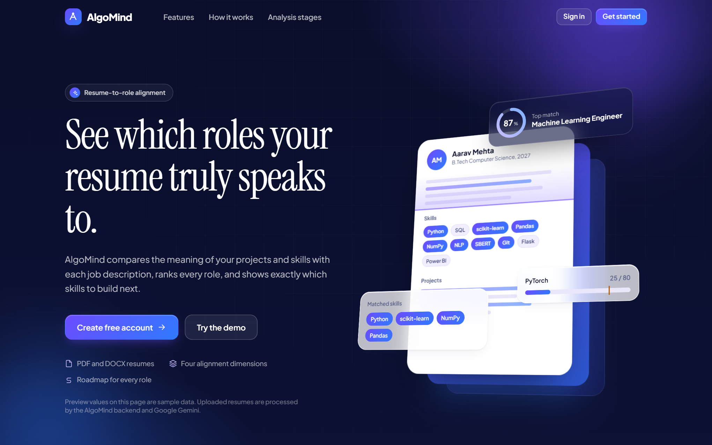

<sub><b>Landing page</b> · midnight navy, violet and electric blue</sub>

<br><br>

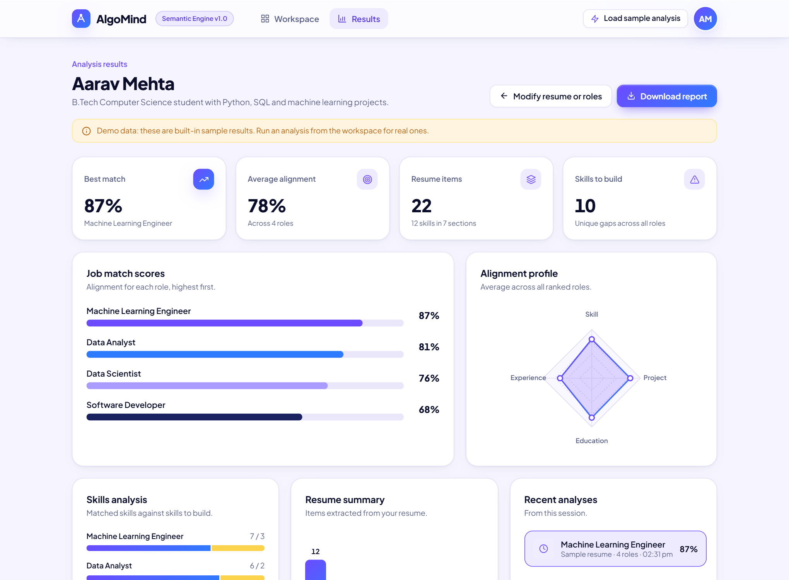

<sub><b>Results dashboard</b> · best match, average alignment, ranked roles and alignment profile</sub>

</div>

<br>

<table>
<tr>
<td width="50%" align="center" valign="top">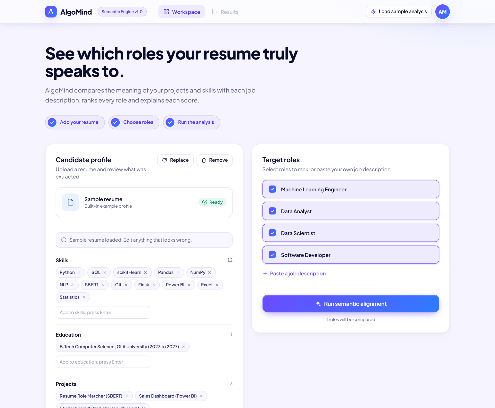<br><sub><b>Workspace</b> · review your profile, choose roles</sub></td>
<td width="50%" align="center" valign="top">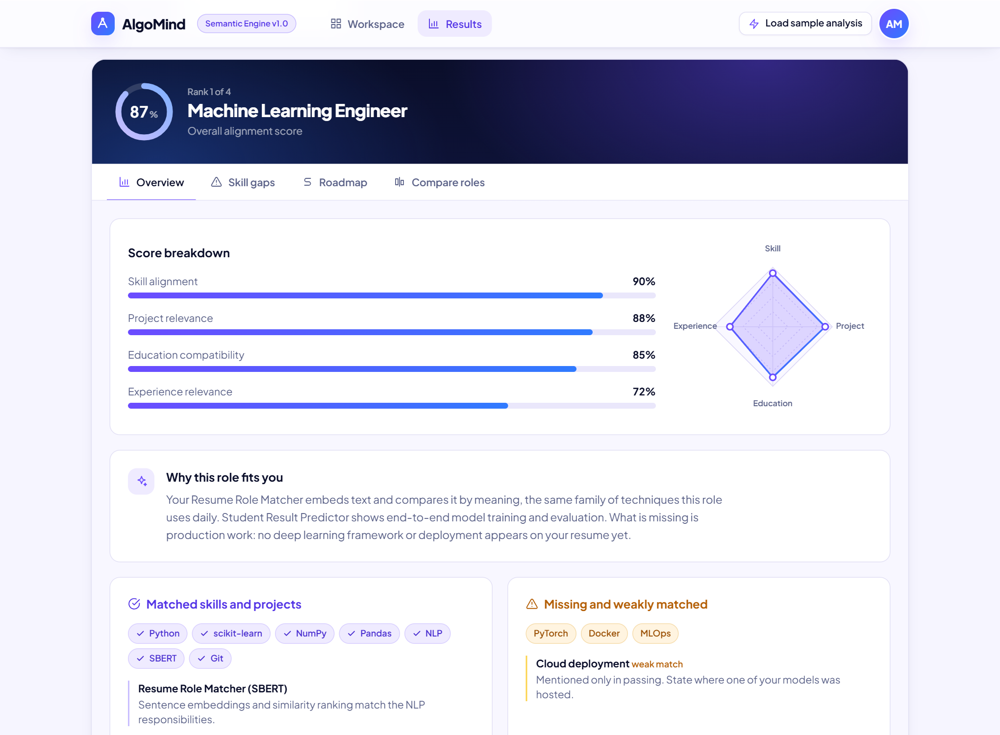<br><sub><b>Role overview</b> · score breakdown and reasoning</sub></td>
</tr>
<tr>
<td align="center" valign="top">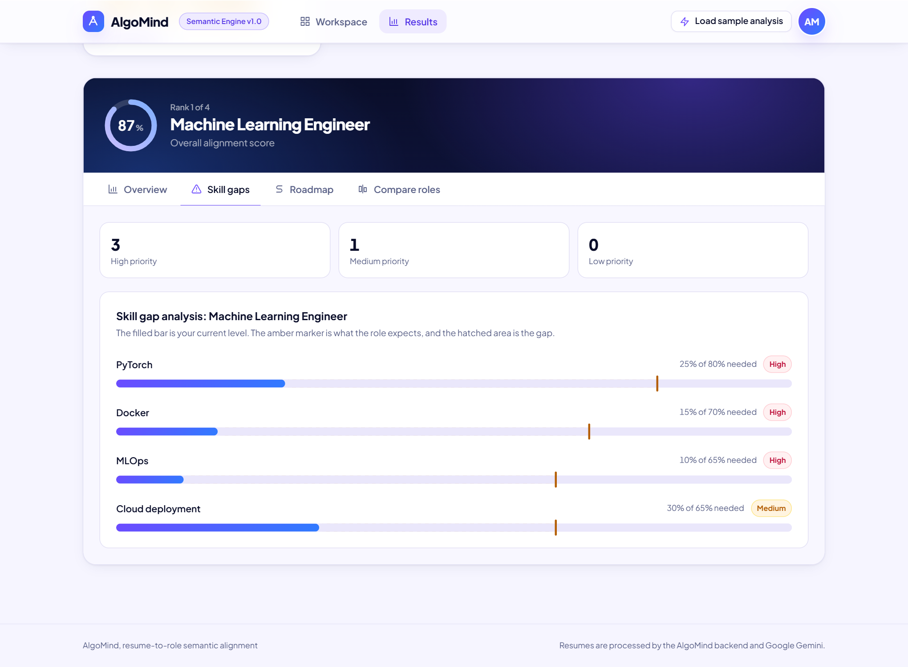<br><sub><b>Skill gaps</b> · current level against expectation</sub></td>
<td align="center" valign="top">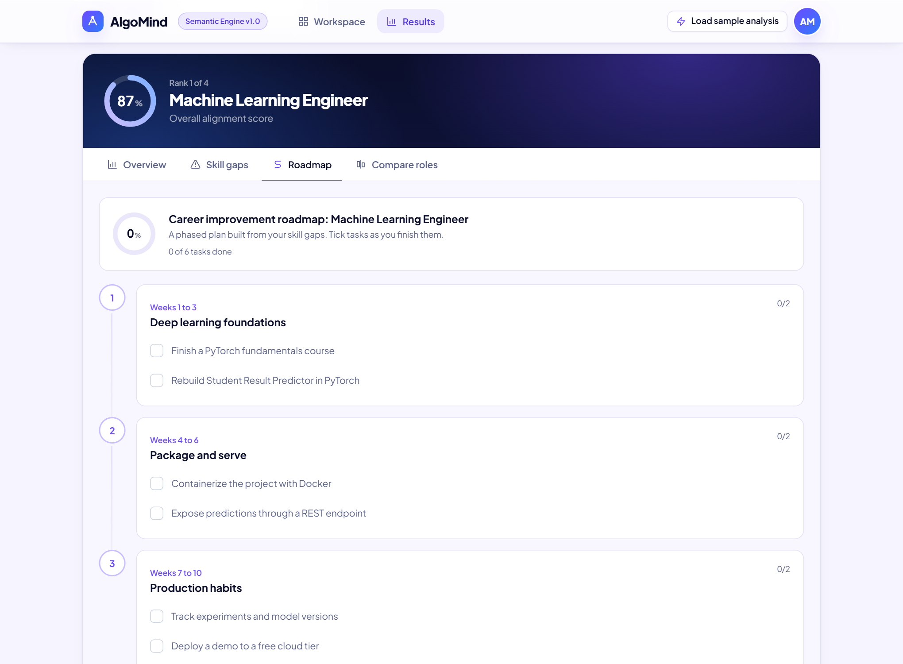<br><sub><b>Roadmap</b> · a phased plan with checkable tasks</sub></td>
</tr>
</table>

<details>
<summary><b>⚖️ See the role comparison view</b></summary>
<br>
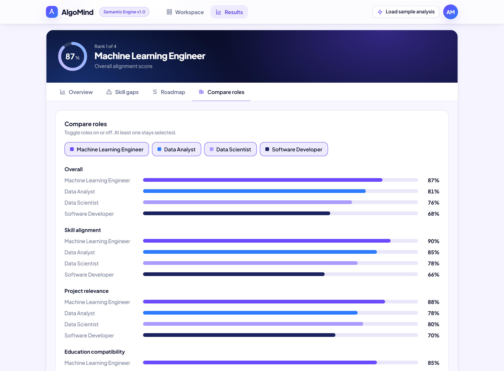
</details>

> [!NOTE]
> Screenshots use the built-in **sample profile** and sample results. The person shown is fictional.

<br>

## 🧠 How AlgoMind thinks

### System architecture

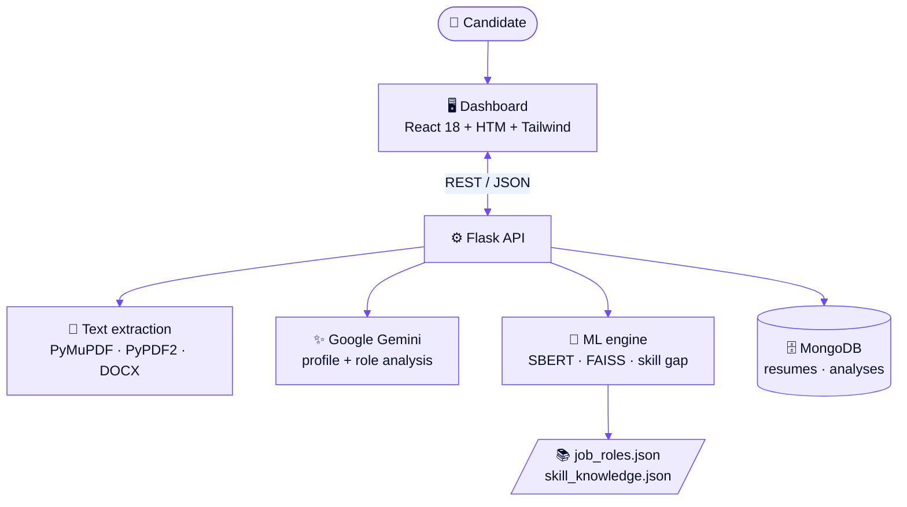

### Request journey

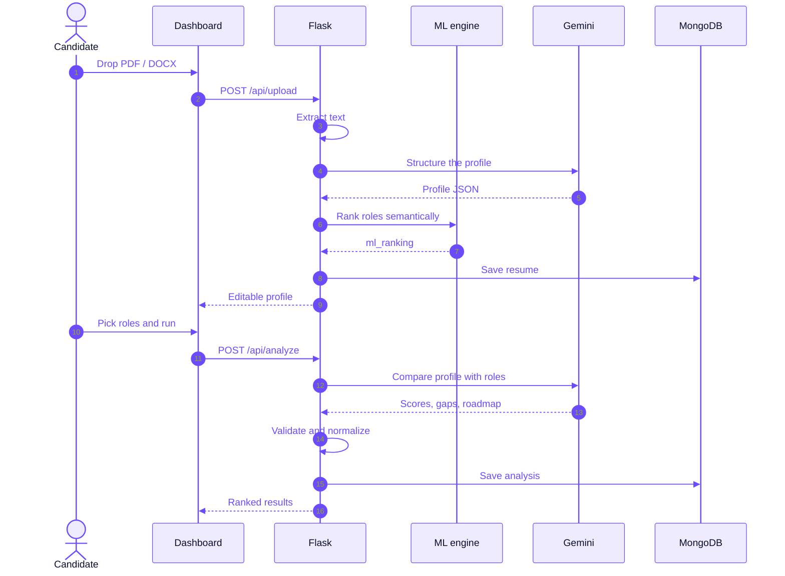

### Two engines, one platform

| | 🧠 Semantic ML engine | ✨ Gemini analysis |
| :--- | :--- | :--- |
| **Runs** | Locally | Google Gemini API |
| **Method** | SBERT embeddings, cosine similarity, FAISS retrieval | Structured prompting at temperature 0, with response validation |
| **Roles** | Shared role library in `data/job_roles.json`, plus pasted job descriptions | The same roles and job descriptions |
| **Output** | Similarity, matched and missing skills, learning tips | Scores, explanation, gaps, roadmap |
| **Where it appears** | Dashboard: engine score on each job card and a "second opinion" panel with FAISS learning tips | Dashboard: ranking, breakdown, gaps and roadmap |

#### The ML scoring formula

```math
\text{Overall Match} = 0.6 \times \text{Semantic Similarity} + 0.4 \times \text{Skill Match \%}
```

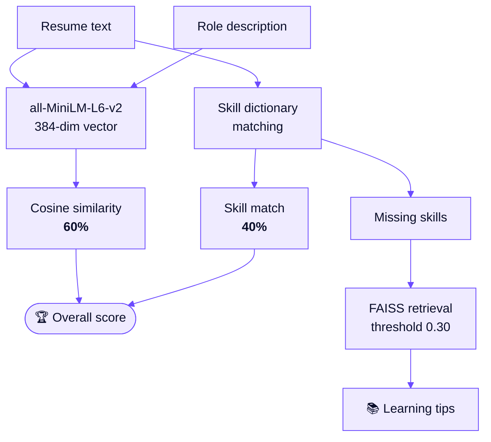

<br>

## 🚀 Quick start

### Prerequisites

- **Python 3.14** (the version the project is developed on) and **Git**
- A **MongoDB** connection string (local or Atlas)
- A **Google Gemini API key** from [Google AI Studio](https://aistudio.google.com/)
- An internet connection (the UI loads libraries and fonts from CDNs)

### 1️⃣ Clone

```bash
git clone https://github.com/yashashvigupta16/MiniProject.git
cd MiniProject
```

### 2️⃣ Install

```powershell
python -m venv Backend\venv
Backend\venv\Scripts\python.exe -m pip install -r requirements.txt
```

### 3️⃣ Configure

Create `Backend/.env`:

```env
MONGO_URI=your_mongodb_connection_string
GEMINI_API_KEY=your_gemini_api_key
GOOGLE_CLIENT_ID=your_google_oauth_client_id   # optional, enables Sign in with Google
```

For **Sign in with Google**, create an OAuth client ID (type *Web application*) in the [Google Cloud Console](https://console.cloud.google.com/apis/credentials) and add `http://localhost:5000` and `http://localhost` as *Authorized JavaScript origins*.

### 4️⃣ Launch 🎉

```powershell
.\run
```

One command starts the backend and frontend, then opens **http://localhost:5000**. Press `Ctrl + C` to stop.

> [!TIP]
> No Node.js and no build step. The first start downloads the SBERT model, so give it a little longer.

<details>
<summary><b>🍎 macOS / Linux</b> (not tested by the team)</summary>

```bash
python3 -m venv Backend/venv
Backend/venv/bin/python -m pip install -r requirements.txt
Backend/venv/bin/python Backend/app.py
```

</details>

<br>

## 🔌 API reference

Base URL: `http://127.0.0.1:5000`

| Method | Endpoint | Purpose | Input |
| :---: | :--- | :--- | :--- |
| 🟢 `GET` | `/api/health` | Server status | none |
| 🟣 `POST` | `/api/upload` | Extract a profile and run ML ranking | form-data `resume` (PDF / DOCX) |
| 🟣 `POST` | `/api/analyze` | Deep role analysis with Gemini | `{ "profile": {}, "roles": [] }` |
| 🟢 `GET` | `/api/config` | Public settings for the page (Google Client ID) | none |
| 🟣 `POST` | `/api/auth/google` | Verifies a Google sign-in and returns the user | `{ "credential": "<Google ID token>" }` |
| 🟣 `POST` | `/api/feedback` | Saves the one-tap "Does this feel right?" answer | `{ "top_role": "...", "agree": true }` |
| 🟣 `POST` | `/api/ml-rank` | ML ranking only, no Gemini call | `{ "resume_text": "..." }` |

<details>
<summary><b>📦 Example: <code>/api/analyze</code></b></summary>

Request

```json
{
  "profile": { "name": "Aarav Mehta", "skills": ["Python", "SQL"] },
  "roles": [{ "id": "da", "title": "Data Analyst", "req_skills": ["SQL", "Excel"] }]
}
```

Response (shortened, illustrative values)

```json
{
  "results": [{
    "id": "da",
    "title": "Data Analyst",
    "score": 74,
    "b": { "Skills match": 70, "Project relevance": 72, "Education fit": 85, "Experience depth": 60 },
    "why": "Strong SQL foundation. Reporting experience is not yet shown.",
    "matched": ["SQL"],
    "missing": ["Excel"],
    "gaps": [["Excel", 20, 70]],
    "road": [["Weeks 1-2", "Spreadsheet skills", ["Practice pivot tables"]]]
  }]
}
```

</details>

<br>

## 📂 Project structure

```text
MiniProject/
├── 🖥️  Frontend/
│   ├── index.html            # Page shell and CDN libraries
│   ├── app.js                # React components and app logic
│   ├── data.js               # Sample data for the demo screens
│   ├── styles.css            # Design tokens, glass surfaces, 3D hero
│   └── tailwind.config.js    # Palette, fonts and shadows
├── ⚙️  Backend/
│   ├── app.py                # Flask API, also serves the frontend
│   ├── db.py                 # MongoDB connection
│   ├── gemini_helper.py      # Prompts, model fallback, validation
│   └── uploads/              # Temporary; each resume is deleted once read
├── 🧠  ml_engine/
│   ├── pdf_parser.py         # PyMuPDF text extraction
│   ├── skill_extractor.py    # Dictionary-based skill detection
│   ├── similarity.py         # SBERT embeddings, cosine similarity
│   ├── skill_gap.py          # Matched and missing skills
│   ├── rag_retriever.py      # FAISS knowledge retrieval
│   └── role_ranker.py        # Weighted role ranking
├── 📚  data/                  # Job roles and skill knowledge base
├── 🎨  docs/                  # Banner and screenshots
├── test_ml.py                # ML pipeline script
├── test_rag.py               # Retrieval script
├── requirements.txt
└── run.bat                   # One-command launcher (Windows)
```

<br>

## 🧪 Testing the ML engine

```powershell
Backend\venv\Scripts\python.exe test_rag.py
```

`test_ml.py` runs the full ranking pipeline. It expects a file named `sample-resume-information-technology.pdf` in the project root, which you supply yourself.

<br>

## 🎨 Design system

| Token | Colour | Used for |
| :--- | :---: | :--- |
| Midnight Navy |  | Hero, headers, text |
| Violet |  | Primary brand |
| Electric Blue |  | Gradient partner |
| Lavender |  | Soft accents |
| Amber |  | Skill-gap markers |

**Type:** Instrument Serif for display, Plus Jakarta Sans for the interface.

<br>

## 🛟 Troubleshooting

| Symptom | Fix |
| :--- | :--- |
| *Could not connect to the backend server* | Make sure the `.\run` terminal is still open |
| `503` / high demand | Gemini is busy. Wait a minute and retry |
| API key error | Check `GEMINI_API_KEY` in `Backend/.env` |
| `DB WARNING` in the terminal | Check `MONGO_URI`. Results still display |
| Unstyled or blank page | Check your internet connection |
| *Could not extract text* | The PDF is probably a scanned image |

<br>

## 🔭 Current scope and next steps

This is an academic mini-project that runs locally.

- [x] Resume upload, profile extraction and editing
- [x] Multi-role analysis, skill gaps, roadmap, comparison and report
- [x] Local semantic ranking with FAISS retrieval
- [x] Show the ML engine ranking inside the dashboard
- [x] Sign in with Google (verified on the server)
- [ ] Email and password accounts (currently a prototype)
- [x] Analysis history and roadmap progress saved in the browser
- [x] One-tap feedback on the top role, stored for evaluation
- [ ] Larger role and knowledge datasets
- [ ] Production deployment

> [!IMPORTANT]
> Uploaded resume files are deleted as soon as their text is read. The extracted profile is stored in MongoDB, and the text is sent to the Google Gemini API for analysis. AI-generated scores are guidance, not hiring decisions.

<br>

## 👥 Team AlgoMind

<div align="center">

**Team 38** &nbsp;·&nbsp; Mini-Project `BCSJ0010` &nbsp;·&nbsp; **GLA University, Mathura**

</div>

<table>
<tr>
<td width="33%" align="center" valign="top">

### 🧠
**[Somya Goyal](https://github.com/heyitsomya)**<br>
<sub>ML & NLP Lead</sub>

SBERT embeddings, NLP processing, text extraction, RAG pipeline, semantic similarity and job matching

</td>
<td width="33%" align="center" valign="top">

### ⚙️
**[Yashashvi Gupta](https://github.com/yashashvigupta16)**<br>
<sub>Backend & Database Lead</sub>

Flask REST API, MongoDB design, Gemini integration, backend logic, data processing and endpoints

</td>
<td width="33%" align="center" valign="top">

### 🎨
**[Shivangi Goel](https://github.com/shivangiigoel01)**<br>
<sub>Frontend & UI/UX Lead</sub>

React development, UI/UX design, upload interface, interactive dashboard, results display and responsive design

</td>
</tr>
</table>

<div align="center"><sub>Shared: system integration, testing, documentation, error handling and the final demonstration</sub></div>

<br>

## 📜 References

1. Reimers, N. and Gurevych, I. (2019). *Sentence-BERT: Sentence Embeddings using Siamese BERT-Networks.* EMNLP.
2. [Sentence-Transformers `all-MiniLM-L6-v2`](https://huggingface.co/sentence-transformers/all-MiniLM-L6-v2)
3. [FAISS](https://github.com/facebookresearch/faiss)
4. [Google Gemini API documentation](https://ai.google.dev/)

<br>

<div align="center">

### Find out where your resume stands.

⭐ **If AlgoMind impressed you, give the repository a star!** ⭐

<sub>Built with 💜 by Team AlgoMind</sub>

</div>
